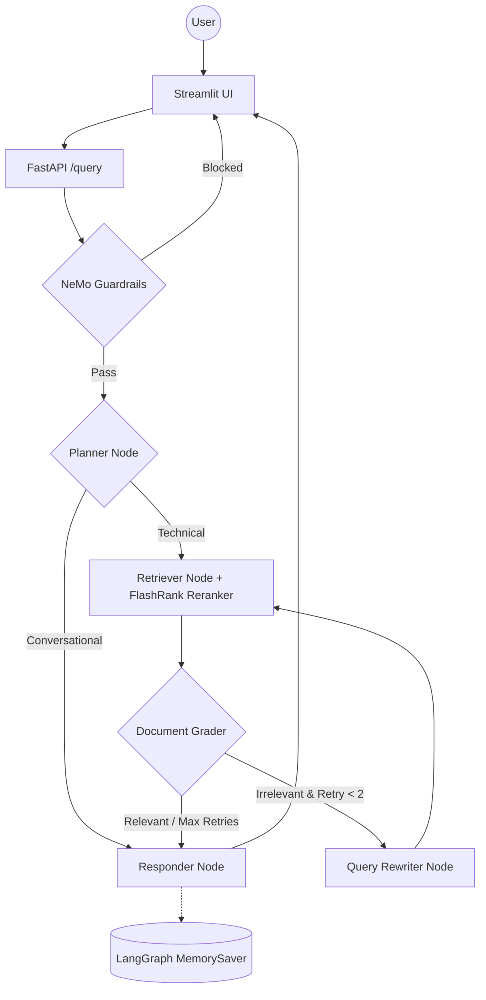

# Enterprise Agentic RAG (Scalable Pipeline)

A production-grade, enterprise-level scalable RAG system built with **LangGraph**, **Google Cloud Platform (GCP)**, and a **Portkey LLM Gateway**. The system distinguishes between technical "True Data" and random "Noisy Data" using semantic re-ranking, history-aware planning, and NeMo Guardrails for input/output safety.

## Key Features

- **Agentic Intelligence**: LangGraph for cyclic reasoning, multi-step planning, and conversation memory.
- **Guardrails**: NeMo Guardrails gate blocks off-topic, jailbreak, and injection inputs before any retrieval.
- **LLM Gateway**: Portkey routes all LLM calls with automatic fallback between primary and backup Groq keys.
- **Enterprise Search**: Qdrant Cloud for high-performance vector search + FlashRank for local semantic reranking.
- **Observability**: Full trace nesting with **Pydantic Logfire** and **LangSmith** across every agent node.
- **Evaluation Suite**: RAGAS-powered eval pipeline (6 metrics) with a dedicated Streamlit demo app.
- **Scalable Infrastructure**: Deployed on **Google Cloud Run** with Cloud Build CI/CD and VPC Connectors.

---

## Agent Intelligence Flow



---

## Project Structure

```text
├── app/
│   ├── agents/
│   │   ├── nodes/         # Planner, Retriever, Grader, Rewriter, Responder LangGraph nodes
│   │   ├── graph.py       # LangGraph orchestration with corrective loop & MemorySaver
│   │   └── state.py       # TypedDict state definition with retry_count & document_score
│   ├── gateway/           # Portkey LLM gateway — primary + fallback Groq routing
│   ├── guardrails/        # NeMo Guardrails input/output filtering
│   ├── ingestion/
│   │   ├── chunking/    # Text splitting strategies
│   │   └── loaders/     # PDF (Document AI), HTML, TXT, DOCX, PPTX parsers
│   ├── services/
│   │   ├── cache/       # Redis semantic caching layer
│   │   └── retrieval/   # Qdrant vector search + FlashRank reranking
│   ├── config.py          # Centralized environment variable management
│   └── main.py            # FastAPI entrypoint — guardrails gate + /query endpoint
├── evals/                 # RAGAS evaluation suite + Streamlit 3-tab demo
├── ui/                    # Streamlit chat interface with reasoning step transparency
├── DATA/                  # Sample datasets (True vs Noisy documentation)
├── Dockerfile             # Production container — serves app/ via uvicorn
└── requirements.txt       # Locked dependencies
```

---

## Tech Stack

| Layer | Technology |
|-------|-----------|
| Orchestration | LangChain + LangGraph |
| LLMs | Groq via **Portkey** gateway |
| Guardrails | NeMo Guardrails |
| Vector DB | Qdrant Cloud |
| Reranking | FlashRank (local, zero-latency) |
| Embeddings | HuggingFace sentence-transformers |
| Cloud Compute | Google Cloud Run (Serverless) |
| Cloud Storage | Google Cloud Storage (GCS) |
| Document Parsing | Google Document AI (PDF) |
| Observability | Pydantic Logfire + LangSmith |
| Evaluation | RAGAS + custom Tool Correctness (Jaccard) |

---

## Getting Started

### 1. Install dependencies

```powershell
python -m venv tenvv
.\tenvv\Scripts\activate
pip install -r requirements.txt
```

### 2. Configure environment

```
# --- GROQ API KEYS ---
GROQ_API_KEY=your_primary_groq_api_key
GUARD_KEY=your_guardrails_groq_api_key
JUDGE_API_KEY=your_eval_judge_groq_api_key

# --- PORTKEY GATEWAY ---
PORTKEY_API_KEY=your_portkey_api_key
GROQ_SLUG=rag
GROQ_SLUG_2=brag

# --- QDRANT VECTOR DB ---
QDRANT_API_KEY=your_qdrant_api_key
QDRANT_CLUSTER_ENDPOINT=your_qdrant_cluster_endpoint

# --- OBSERVABILITY (Logfire & LangSmith) ---
LOGFIRE_TOKEN=your_logfire_token
LANGSMITH_TRACING=true
LANGSMITH_ENDPOINT=[https://api.smith.langchain.com](https://api.smith.langchain.com)
LANGSMITH_API_KEY=your_langsmith_api_key
LANGSMITH_PROJECT="entreprise_rag"

# --- GOOGLE CLOUD & DOCUMENT AI ---
PROJECT_ID=your_gcp_project_id
LOCATION=us-central1
GCP_DOC_AI_LOCATION=us
GCP_DOC_AI_PROCESSOR_ID=your_document_ai_processor_id
GCP_RAW_BUCKET=your_gcp_raw_bucket_name
GCP_PROCESSED_BUCKET=your_gcp_processed_bucket_name
PROJECT_NUMBER_GCP=your_project_number

# --- REDIS CACHE ---
REDIS_HOST=localhost
REDIS_PORT=6379

```

### 3. Run data ingestion

```powershell
python -m app.ingestion.processor DATA --wipe
```

### 4. Launch the app

```powershell
# Terminal 1 — FastAPI backend
uvicorn app.main:app --reload --port 8000

# Terminal 2 — Streamlit UI
streamlit run ui/app.py
```

### 5. Run the eval suite (optional)

```powershell
# Requires the FastAPI backend running on :8000
streamlit run evals/app.py
```

---


---

*Built for High-Scale Enterprise Document Intelligence.*
